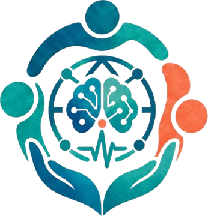
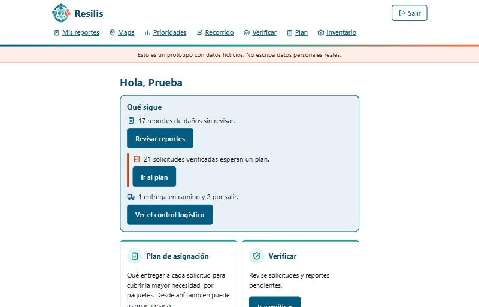
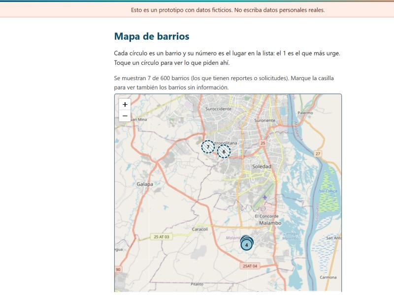
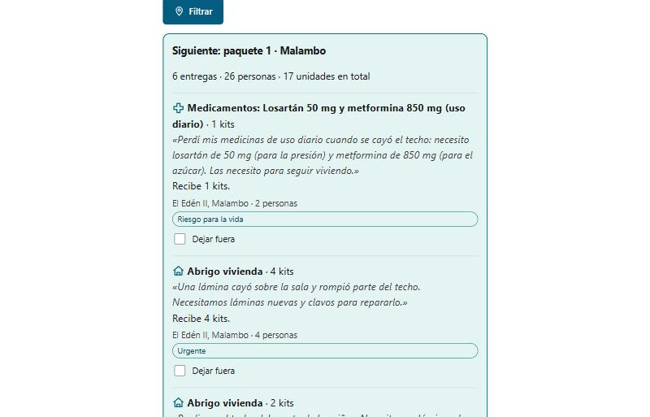

<div align="center">



# Resilis

**Decisiones inteligentes, recursos optimizados, vidas protegidas.**

Plataforma web para priorizar la ayuda después de un desastre y comprobar que llegó a quien la pidió.

[**Ver el sitio en vivo**](https://resilis.dorelys.dev) · [Cómo funciona](https://resilis.dorelys.dev/como-funciona) · [Requerimientos](Requerimientos/main.pdf) · [Propuesta](propuesta_integrada.md)

</div>

[](https://github.com/dorelysm/resilis/actions/workflows/pruebas.yml)  

> **Prototipo del Rally Latinoamericano de Innovación 2026.** Los datos son ficticios y simulados. Equipo **NEXUS INNOVA 4.0**, Corporación Universitaria Americana, Colombia.

---

## El problema

Tras un terremoto, un alud o una inundación, las comunidades quedan sin comunicaciones y con rutas bloqueadas, y piden ayuda todas a la vez. Con recursos limitados e información fragmentada, quienes coordinan la respuesta deben decidir en minutos **a quién atender primero, dónde concentrar los esfuerzos y qué recursos asignar**. Después, casi nunca hay forma de comprobar que la ayuda llegó.

Es el reto *«Optimización y priorización de recursos y esfuerzos en la post-emergencia»*. Resilis lo responde con tres ideas:

1. **Priorizar con un criterio explicable**, y decir qué tan confiable es cada dato.
2. **Repartir lo que hay** de la forma que cubre más necesidad.
3. **Dar seguimiento hasta la entrega**, con un código de un solo uso.

## Capturas

| Inicio de una entidad coordinadora | Mapa de prioridades por barrio |
|---|---|
|  |  |

| Plan de entregas por paquetes |
|---|
|  |

## Cómo funciona

```text
Se pide ayuda ─► Se verifica ─► Se calcula la prioridad ─► Se arma el plan ─► Se aprueba ─► Se entrega con código
 (celular)       (brigadista)    (barrio y solicitud)      (inventario real)   (por paquetes)   (y se confirma)
```

- **Territorio:** 23 municipios y 600 barrios y centros poblados del Atlántico.
- **Prioridad:** índice multicriterio (TOPSIS) para barrios y para solicitudes, mostrado como *Alta*, *Media* o *Baja*. Considera gravedad, urgencia, personas expuestas, accesibilidad y recursos (barrios), y urgencia, vulnerabilidad, personas en el hogar, tiempo de espera y prioridad del barrio (solicitudes).
- **Confianza:** cada dato tiene una confianza según su fuente, si fue verificado, qué tan reciente es y si otros reportes lo confirman. Las alertas señalan dónde falta información.
- **Plan de entregas:** optimización por programación lineal entera (SciPy `milp`) con inventario por lote, prioridad de lo que vence antes, cobertura mínima de lo más prioritario y cercanía del centro de acopio. Se compara con una asignación simple de referencia.
- **Aprobación humana por paquetes:** el plan se divide en paquetes de hasta 6 entregas del mismo municipio. Hasta que alguien aprueba, no se reserva nada.
- **Entrega con código:** al aprobar se genera un código de un solo uso que el equipo debe recibir para confirmar la entrega, también sin conexión.
- **Seguimiento:** quien pidió ve en un mapa cómo se acerca su ayuda; quien dona ve por dónde va, en una zona aproximada y sin datos de quien recibe.

Hay una explicación detallada, paso a paso, en [resilis.dorelys.dev/como-funciona](https://resilis.dorelys.dev/como-funciona).

## Para quién es

| Rol | Qué hace |
|---|---|
| Persona que necesita ayuda | Pide ayuda, avisa de daños y sigue su solicitud |
| Donante | Registra donaciones y ve por dónde van |
| Brigadista | Verifica solicitudes y reportes, y consulta el mapa |
| Entidad coordinadora | Verifica, prioriza, aprueba el plan y controla las entregas |
| Centro de acopio | Confirma lo recibido y lleva el inventario |
| Equipo de entrega | Lleva la ayuda y la confirma con el código |
| Administrador | Gestiona cuentas y revisa la auditoría |

## Seguridad y privacidad

- Contraseñas con scrypt y sal, sesión firmada, token CSRF en cada formulario y acceso por rol.
- El servidor **no guarda el código de entrega**, solo su huella con sal. El código vence a las 72 horas y se bloquea tras 5 intentos incorrectos.
- Registro de auditoría **encadenado por hash** (SHA-256): cada evento depende del anterior, así que cualquier alteración se detecta. No contiene datos personales.
- Autorización de datos al registrarse, en línea con la Ley 1581 de 2012. Los donantes nunca ven direcciones ni nombres.

## Tecnología

Python 3.12 · FastAPI · SQLAlchemy 2 · PostgreSQL · Jinja2 (HTML en el servidor, sin framework de JavaScript) · SciPy y NumPy · Leaflet con mapas de OpenStreetMap · desplegado en Railway.

Accesibilidad revisada con axe-core (WCAG 2.2 AA), diseñado para el celular y para conexiones débiles.

## Cómo ejecutarlo

Requisitos: Python 3.12, [uv](https://docs.astral.sh/uv/) y Docker (solo para PostgreSQL).

```bash
cd prototipo
uv sync                      # instala las dependencias
docker compose up -d         # PostgreSQL local en el puerto 5440
cp .env.example .env         # variables de entorno
SEMBRAR_DEMO=true uv run uvicorn app.main:app --reload
```

Con `SEMBRAR_DEMO=true` la primera vez se carga el territorio y se genera un escenario simulado. Abra <http://127.0.0.1:8000>. Más detalles (variables, páginas, escenarios y operación) en [`prototipo/README.md`](prototipo/README.md).

### Pruebas

```bash
cd prototipo
uv run pytest -q
```

La suite (más de 330 pruebas) cubre el modelo de prioridad, el plan, el código de entrega, la cadena de auditoría, los permisos por rol y la accesibilidad de las páginas.

## Estructura del repositorio

```text
prototipo/          Aplicación web: app/ (código), tests/, data/ (barrios y viviendas), scripts/
Requerimientos/     Documento de requerimientos (LaTeX y PDF)
Entregables/        Análisis de experiencia de usuario
Datos/              Datos abiertos consultados
docs/capturas/      Capturas de pantalla de este README
formulario.md       Formulario de postulación al Rally (incluye presupuesto)
propuesta_integrada.md, reto.md, ideas_consolidadas.md   Propuesta y decisiones
referencias.bib     Referencias de la revisión de literatura
```

## Datos y atribuciones

- Territorio (23 municipios, 600 barrios y centros poblados) y mapas: © colaboradores de [OpenStreetMap](https://www.openstreetmap.org/copyright), licencia ODbL.
- Estimación de viviendas por municipio 2018-2035, departamento del Atlántico: datos abiertos de Colombia.
- Mapas interactivos con [Leaflet](https://leafletjs.com/), licencia BSD-2-Clause.
- Todas las personas, solicitudes, reportes y donaciones del prototipo son **simuladas**, con identidades ficticias. La posición del equipo de entrega en el mapa también lo es.

## Equipo

**NEXUS INNOVA 4.0**, Corporación Universitaria Americana (Colombia).

Dorelys Martinez (líder) · Adriana Barrios Paez · Carmela Miranda Gutierrez · Evelin Gómez Vergara · Maritza Domínguez Cervantes · Leandro Rodríguez Polo · Stefania De La Cruz

Mentora: Abril Isabel García Caro.

## Uso de inteligencia artificial

Se usó Claude (Anthropic), incluido Claude Code, para organizar y redactar las ideas, clasificar los resultados de la búsqueda bibliográfica, proponer el diseño del modelo, programar y probar el prototipo y preparar los documentos. Las decisiones del proyecto y la revisión de las fuentes son del equipo.

## Licencia

- **Código** (`prototipo/`): [MIT](LICENSE).
- **Documentos** (propuesta, formulario, requerimientos, análisis y textos): [CC BY 4.0](LICENSE-DOCS.md). Dé el crédito a NEXUS INNOVA 4.0, Corporación Universitaria Americana.
- Los datos de OpenStreetMap y la biblioteca Leaflet conservan sus propias licencias (ver arriba). Las fotografías del equipo no se licencian para reutilización.

Para reportar un problema de seguridad, vea [`SECURITY.md`](SECURITY.md). Esperamos que la comunidad siga el [código de conducta](CODE_OF_CONDUCT.md).
